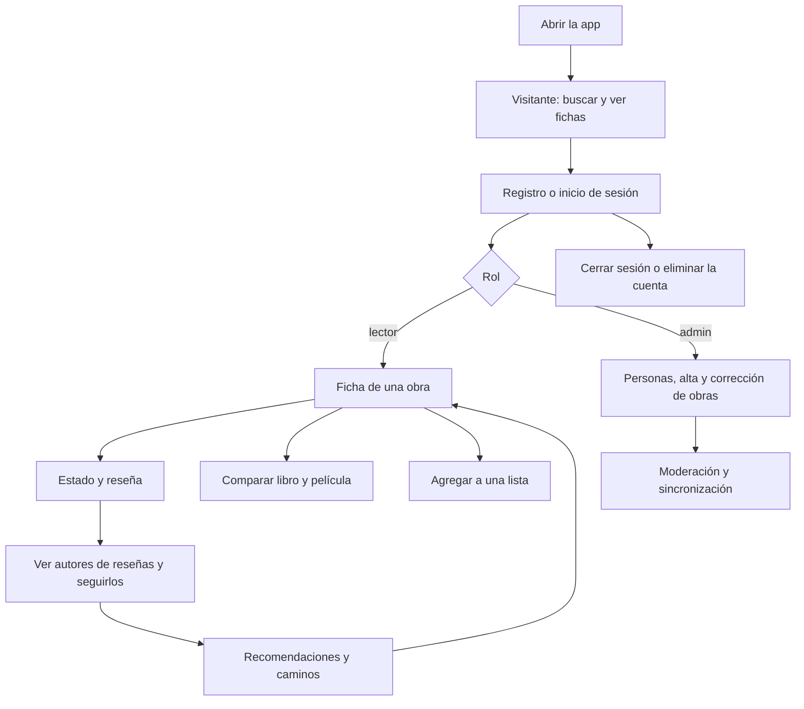

# Endpoints de la API: Del Libro a la Pantalla

Lista de endpoints REST (D-52) que cubren el flujo completo de la aplicación. La lista y su prioridad están aprobadas (D-59, sección 2.11); lo ya construido se ve en `openapi.yaml`. Las operaciones (`O`, `AP`, `CG`), las reglas y los límites salen de los documentos de diseño; **las rutas, los cuerpos y las respuestas son una propuesta nueva**. El contrato definitivo irá en `openapi.yaml`.

## 1. Convenciones

| Tema | Regla |
|---|---|
| Prefijo | `/api/v1` (todas las rutas de abajo van después de él) |
| Formato | JSON, campos en `snake_case` |
| Sesión | `Authorization: Bearer <token>` (D-35) |
| Acceso | **P** público (visitante), **L** con sesión (lector o administrador), **A** solo administrador |
| Rutas con respuesta según quién pide | Con token, la respuesta se adapta: lo propio del usuario y, para el administrador, borradores y ocultas |
| Ids | UUID en minúsculas, generados por la API (D-11) |
| Listados largos | Paginados. El tamaño y el estilo están por decidir (sección 6) |

**Errores.** Cuerpo propuesto: `{ "error": { "codigo", "mensaje", "campos" } }`.

| Estado | Cuándo | Dónde aplica |
|---|---|---|
| 400 | Entrada inválida | Toda ruta con parámetros o cuerpo |
| 401 | Sin sesión válida | Todas las rutas L y A |
| 403 | Sin permiso | Todas las rutas A, y lo reservado a seguidores o al dueño |
| 404 | No existe, es de otro usuario o no es visible | Rutas con `{id}` |
| 409 | Duplicado o conflicto con una regla | Se indica en cada ruta |
| 503 | Una base no responde (recuperable) | Cualquiera |

Las tablas solo anotan los errores **propios** de cada ruta.

**Límites que valida la API**

| Dato | Límite |
|---|---|
| `correo`, `nombre` de usuario, `biografia` | 254, 100 y 500 caracteres |
| `calificacion`, `puntuacion` | Entero de 1 a 5 |
| `titulo`, `sinopsis` | 1-200 y 1-3000 |
| `generos` | 1 a 5, de hasta 40 caracteres, sin repetidos |
| `anio_publicacion_original`, `anio_estreno`, año de edición | -3000 a 2100; 1888 a 2100; 1 a 2100 |
| `duracion_min`, `paginas` | 1-1000 y 1-10000 |
| `ediciones`, `plataformas`, `reparto`, `aspectos` | Hasta 50, 30, 300 y de 1 a 10 |
| `isbn` | Opcional, 13 dígitos con dígito de control, único |
| `datos_tecnicos` | `idioma_original` (40) y `paises` (1-10) obligatorios; `productoras` (hasta 20) y `clasificacion` (20) opcionales |
| `veredicto` | `preferencia`: `libro`, `pelicula` o `empate`; `comentario` hasta 2000 |
| Aspecto | `nombre` hasta 60 (sin repetir), `comentario` hasta 1000 |
| Nombre de persona y `personaje`; nombre de lista; nombre de plataforma | 150; 100; 100 |
| `portada_url`, `foto_url` | `https://`, hasta 500 |

## 2. Endpoints (51)

`?` marca un campo opcional. El bloque es el de `../arquitectura/05-orden-de-construccion.md`.

### 2.1 Salud, cuentas y sesión (bloques 0, 1 y 5)

| ID | Método y ruta | Acc. | Entrada | Respuesta y errores propios | Operaciones | RF |
|---|---|---|---|---|---|---|
| EP-01 | `GET /salud` | P | — | 200 con el estado de la API y de cada base | — | — |
| EP-02 | `POST /auth/registro` | P | `correo`, `password`, `nombre` | 201 `usuario_id`. 409 correo en uso | O1 | 01 |
| EP-03 | `POST /auth/sesion` | P | `correo`, `password` | 201 `token`, `expira_en`, `usuario`. 401 con el mismo mensaje si falla el correo o la contraseña | O2 | 02 |
| EP-04 | `DELETE /auth/sesion` | L | — | 204 | O23 | 02 |
| EP-05 | `GET /me` | L | — | 200 `usuario_id`, `correo`, `nombre`, `biografia`, `rol` | O22, O17 | 03 |
| EP-06 | `PATCH /me` | L | `nombre?`, `biografia?` | 200 perfil | O3 | 03 |
| EP-07 | `DELETE /me` | L | — | 204. Las copias se limpian después (bloque 5) | O4 | 04 |

### 2.2 Catálogo (bloque 2; búsqueda por persona en el 4)

| ID | Método y ruta | Acc. | Entrada | Respuesta y errores propios | Operaciones | RF |
|---|---|---|---|---|---|---|
| EP-08 | `GET /obras` | P | `q`, `por=titulo\|persona` | 200 `obra_id`, `tipo`, `titulo`, `anio`, `portada_url`; por persona, además `persona` y `vinculo`. Solo palabras completas | AP-03; CG-01 + AP-04 | 05 |
| EP-09 | `GET /obras/{obra_id}` | P | — | 200 ficha según `tipo`: libro (ediciones, `autores`, `adaptaciones`) o película (plataformas, reparto, `directores`, `libro_origen`). Siempre `promedio` y `total_resenas`; con token, `mi_estado` y `mi_resena` | AP-01, AP-02, O17, CG-03, CG-04, CG-05, AP-04 | 06, 07, 14, 15, 23 |

### 2.3 Reseñas y estados (bloque 3; moderación en el 7)

| ID | Método y ruta | Acc. | Entrada | Respuesta y errores propios | Operaciones | RF |
|---|---|---|---|---|---|---|
| EP-10 | `GET /resenas` | P | `obra_id` o `usuario_id` (uno de los dos), paginación | 200 recientes primero, con autor y obra. Por usuario exige sesión y seguirlo (403). El administrador ve también las ocultas (consulta **nueva**) | O17, AP-04 | 06, 07, 18, 22 |
| EP-11 | `PUT /obras/{obra_id}/resena` | L | `calificacion`, `texto?` | 201 al publicar, 200 al editar la propia. Devuelve `resena_id`, `promedio`, `total_resenas` | AP-05, O7, O8 | 12, 13, 14 |
| EP-12 | `PATCH /resenas/{resena_id}` | A | `oculta` | 200. El promedio se recalcula | O10 | 18 |
| EP-13 | `DELETE /resenas/{resena_id}` | L | — | 204. El dueño o el administrador. El estado de la obra no cambia | O9, O10 | 14, 18 |
| EP-14 | `PUT /me/estados/{obra_id}` | L | `estado`: `pendiente`, `en_curso`, `terminada` | 200 | AP-05, O11 | 15 |
| EP-15 | `GET /me/estados` | L | `estado?` | 200 obras con título y estado | O17, AP-04 | 15 |

### 2.4 Exploración y recomendaciones (bloque 4)

| ID | Método y ruta | Acc. | Entrada | Respuesta y errores propios | Operaciones | RF |
|---|---|---|---|---|---|---|
| EP-16 | `GET /exploracion/caminos` | L | `origen`, `destino` (persona u obra) | 200 `caminos` (nodos y relaciones, con títulos); vacío si no hay. 400 si son iguales (D-49) | CG-06, AP-04 | 24 |
| EP-17 | `GET /personas/{persona_id}/autores-relacionados` | L | — (la persona es un director) | 200 autores con el libro y la película que los unen | CG-07, AP-04 | 25 |
| EP-18 | `GET /me/recomendaciones` | L | — | 200 `libros` (con libro de partida y director) y `peliculas` (con su libro y cuántos seguidos lo leyeron) | O18, CG-08, CG-09, AP-04 | 26, 27 |

### 2.5 Red social (seguir en el bloque 4; ver a los seguidos en el 6)

| ID | Método y ruta | Acc. | Entrada | Respuesta y errores propios | Operaciones | RF |
|---|---|---|---|---|---|---|
| EP-19 | `POST /me/seguidos` | L | `usuario_id` | 201. 400 a sí mismo; 409 ya lo sigue; 404 no existe | O15 | 21 |
| EP-20 | `DELETE /me/seguidos/{usuario_id}` | L | — | 204, también si no lo seguía | O16 | 21 |
| EP-21 | `GET /me/seguimientos` | L | — | 200 `seguidos` y `seguidores` | O17 | 21, 22 |
| EP-22 | `GET /usuarios/{usuario_id}` | L | — | 200 `nombre`, `biografia`, `lo_sigo`; si lo sigue, además `listas` | O17 | 22 |

### 2.6 Reseñas comparativas (bloque 5; moderación en el 7)

| ID | Método y ruta | Acc. | Entrada | Respuesta y errores propios | Operaciones | RF |
|---|---|---|---|---|---|---|
| EP-23 | `GET /comparativas` | P | `libro_id` y `pelicula_id`, `usuario_id`, o los tres; paginación | 200 recientes primero. Las ocultas solo para su autor y el administrador | AP-19, AP-21, AP-23, AP-04 | 16, 17, 18, 22 |
| EP-24 | `GET /comparativas/{comparativa_id}` | P | — | 200. Una oculta solo la ven su autor y el administrador | AP-20 | 16 |
| EP-25 | `POST /comparativas` | L | `libro_id`, `pelicula_id`, `veredicto`, `aspectos` | 201. 404 obra no publicada; 409 sin adaptación o ya existe; 503 si el grafo no responde (no se guarda) | AP-05, CG-10, AP-18 | 16 |
| EP-26 | `PUT /comparativas/{comparativa_id}` | L | `veredicto`, `aspectos` | 200. 404 si no es suya | AP-24 | 17 |
| EP-27 | `PATCH /comparativas/{comparativa_id}` | A | `oculta` | 200 | AP-26 | 18 |
| EP-28 | `DELETE /comparativas/{comparativa_id}` | L | — | 204. El dueño o el administrador | AP-25, AP-27 | 17, 18 |

### 2.7 Listas (bloque 6)

| ID | Método y ruta | Acc. | Entrada | Respuesta y errores propios | Operaciones | RF |
|---|---|---|---|---|---|---|
| EP-29 | `GET /me/listas` | L | — | 200 | O17 | 19 |
| EP-30 | `POST /me/listas` | L | `nombre` | 201 `lista_id`. Se permiten nombres repetidos | O12 | 19 |
| EP-31 | `GET /listas/{lista_id}` | L | — | 200 obras en orden, con título. Dueño o seguidor | O17, AP-04 | 20, 22 |
| EP-32 | `PATCH /listas/{lista_id}` | L | `nombre?`, `obra_ids?` (orden nuevo) | 200. 400 si `obra_ids` no son exactamente los de la lista | O12, O14 | 19, 20 |
| EP-33 | `DELETE /listas/{lista_id}` | L | — | 204 | O12 | 19 |
| EP-34 | `POST /listas/{lista_id}/obras` | L | `obra_id` | 201 al final de la lista. 409 ya está | AP-05, O13 | 20 |
| EP-35 | `DELETE /listas/{lista_id}/obras/{obra_id}` | L | — | 204 | O13 | 20 |

### 2.8 Administración: personas y alta de obras (servicio en el bloque 2, pantallas en el 7)

| ID | Método y ruta | Acc. | Entrada | Respuesta y errores propios | Operaciones | RF |
|---|---|---|---|---|---|---|
| EP-36 | `GET /admin/personas` | A | `q` | 200 `persona_id`, `nombre`, `foto_url`. La API sanea el texto (D-41) | CG-02 | 10 |
| EP-37 | `POST /admin/personas` | A | `nombre`, `foto_url?` | 201 `persona_id`. La app busca antes con EP-36 (D-15) | CG-13 | 10 |
| EP-38 | `PATCH /admin/personas/{persona_id}` | A | `foto_url` (nulo la quita) | 200. Regenera el reparto de sus películas | CG-24, CG-25, CG-20, AP-17 | 10 |
| EP-39 | `POST /admin/libros` | A | datos de la ficha, `ediciones?`, `autores` (ids, mínimo 1) | 201 `obra_id`, `estado_publicacion: borrador` | AP-07, O5, CG-11, CG-14 | 08, 10 |
| EP-40 | `POST /admin/peliculas` | A | datos de la ficha, `libro_id`, `directores` (mín. 1), `reparto` `[{persona_id, personaje, orden}]` (mín. 1) | 201 `obra_id` y estado de la película y del libro. 404 libro o persona | AP-05, AP-08, O5, CG-11, CG-15, CG-04, CG-14, CG-20, AP-17, CG-03, CG-05, AP-09 | 08, 10, 11 |
| EP-41 | `POST /admin/obras/{obra_id}/publicacion` | A | — | 200: completa un alta interrumpida. 409 indica qué falta | AP-05, O5, CG-11, CG-03, CG-04, CG-05, CG-20, AP-17, AP-09 | 08 |

### 2.9 Administración: corrección del catálogo (bloques 2 y 7)

| ID | Método y ruta | Acc. | Entrada | Respuesta y errores propios | Operaciones | RF |
|---|---|---|---|---|---|---|
| EP-42 | `PATCH /admin/obras/{obra_id}` | A | solo lo que cambia, según el tipo (sin ediciones, plataformas ni reparto) | 200 | AP-10 | 08 |
| EP-43 | `POST /admin/libros/{obra_id}/ediciones` | A | `isbn?`, `paginas`, `editorial`, `idioma`, `anio` | 201 `edicion_id`. 409 ISBN repetido | AP-11 | 09 |
| EP-44 | `PATCH /admin/libros/{obra_id}/ediciones/{edicion_id}` | A | lo que cambia | 200. 409 ISBN repetido | AP-12 | 08 |
| EP-45 | `DELETE /admin/libros/{obra_id}/ediciones/{edicion_id}` | A | — | 204 | AP-13 | 08 |
| EP-46 | `POST /admin/peliculas/{obra_id}/plataformas` | A | `nombre` | 201. 409 repetida | AP-14 | 09 |
| EP-47 | `PATCH /admin/peliculas/{obra_id}/plataformas/{nombre}` | A | `nombre` nuevo (el de la ruta va codificado) | 200. 409 repetida | AP-15 | 08 |
| EP-48 | `DELETE /admin/peliculas/{obra_id}/plataformas/{nombre}` | A | — | 204 | AP-16 | 08 |
| EP-49 | `POST /admin/obras/{obra_id}/creditos` | A | `persona_id`, `vinculo` (`escribio`, `dirigio`, `actuo`); en `actuo`, `personaje` y `orden` | 201. 400 el vínculo no corresponde al tipo de obra; 409 ya registrado, `orden` repetido o 300 personas | CG-14, CG-20, AP-17 | 10 |
| EP-50 | `PUT /admin/peliculas/{obra_id}/libro-origen` | A | `libro_id` | 200. 409 ya tiene libro (RN-07) | CG-15, CG-04 | 11 |

### 2.10 Estado de la sincronización (bloque 8)

| ID | Método y ruta | Acc. | Entrada | Respuesta y errores propios | Operaciones | RF |
|---|---|---|---|---|---|---|
| EP-51 | `GET /admin/sincronizacion` | A | — | 200 eventos `pendiente`, `procesado`, `fallido` y últimos errores (consulta **nueva**) | — | — |

EP-51 es la evidencia de consistencia que propone `05-orden-de-construccion.md` (9.1). CG-15 incluye el bloqueo previo de `CG-15-bloqueo` (D-23).

### 2.11 Prioridad (D-59)

| Tramo | Cuándo | Endpoints |
|---|---|---|
| **19** | La demo | EP-01 a EP-06, EP-08 a EP-11, EP-13 a EP-20 y EP-22 |
| **41** | Si se puede | Todos menos EP-24, 38, 42, 44, 45, 47, 48, 49, 50 y 51 |
| **51** | Solo si sobra tiempo | Todos |

El catálogo de la demo sale de la semilla: el alta de obras no se construye hasta el tramo de los 41.

## 3. Flujo completo de la aplicación

Al desarrollar y antes de la demo, EP-01 confirma que el teléfono llega a la API y que las tres bases responden.

### F1. Visitante (sin sesión)
1. EP-08 busca por título o por persona.
2. EP-09 abre la ficha, con autores, directores y adaptación.
3. EP-10 lee las reseñas; EP-23 y EP-24, las comparativas.
4. Para reseñar, comparar, seguir o explorar, la app pide iniciar sesión.

### F2. Entrar a la aplicación
1. EP-02 registra (evento `usuario_creado` → nodo `Usuario`).
2. EP-03 inicia sesión; la app guarda el token en el almacenamiento seguro.
3. EP-05 confirma la sesión al reabrir la app y dice el rol; con 401, vuelve al inicio de sesión.
4. EP-06 edita el perfil.

### F3. Leer, ver y reseñar
1. EP-08 → EP-09, que ya trae mi estado y mi reseña.
2. EP-14 marca `pendiente` o `en_curso`.
3. EP-11 publica la reseña: en una transacción quedan reseña, estado `terminada`, promedio y evento `obra_leida`.
4. El worker crea `leyó` si la obra es un libro. La reseña se ve de inmediato; las recomendaciones, un instante después.
5. EP-11 la edita y EP-13 la elimina. EP-15 muestra "mis obras".

### F4. Comparar el libro con su película
1. Desde la ficha del libro (EP-09), elegir una adaptación.
2. EP-23 con la pareja y mi `usuario_id`: si ya existe, se edita (EP-26); si no, se crea (EP-25).
3. EP-23 solo con la pareja muestra las de otros. EP-28 elimina la propia.

### F5. Organizar listas
1. EP-29 muestra mis listas; EP-30 crea una.
2. EP-34 agrega obras (libros o películas) desde la ficha.
3. EP-31 la muestra; EP-32 la renombra o reordena; EP-35 quita una obra; EP-33 la borra.

### F6. Seguir a otros
1. En las reseñas de una ficha (EP-10), tocar el nombre del autor → EP-22.
2. EP-19 lo sigue (evento `seguimiento_creado` → `sigue`).
3. EP-22 muestra sus listas (cada una con EP-31); EP-10 y EP-23 por `usuario_id`, sus reseñas y comparativas; EP-21, la red propia.
4. EP-20 deja de seguirlo.

### F7. Descubrir (caso integrado de la demo)
1. Tras F3 y F6: EP-18 recomienda películas de los libros que leyeron los seguidos (PostgreSQL → worker → Neo4j → MongoDB) y libros a partir de los que gustaron.
2. EP-08 por persona entrega los `persona_id`; EP-16 muestra el camino entre dos nodos.
3. Desde los directores de una ficha, EP-17 lista autores relacionados.

### F8. Administrador: dar de alta una adaptación
1. EP-36 busca cada persona; EP-37 registra solo las que no existan.
2. EP-39 crea el libro: queda en `borrador`.
3. EP-40 crea su primera película con director y reparto: publica el libro y después la película.
4. Si algo falla a medias, la obra sigue en `borrador`: se completan las relaciones (EP-49 y EP-50) y se publica con EP-41.
5. Una segunda adaptación del mismo libro es otra vez EP-40.

### F9. Administrador: mantener y moderar
1. EP-42 corrige fichas; EP-43 a EP-48, ediciones y plataformas.
2. EP-38 pone, cambia o quita una foto y regenera los repartos.
3. Modera con EP-10 y EP-23 (ve las ocultas), EP-12, EP-13, EP-27 y EP-28.
4. EP-51 muestra que los eventos se procesaron.

### F10. Salir
- EP-04 cierra la sesión.
- EP-07 elimina la cuenta: cascada en PostgreSQL y, por el evento `usuario_eliminado`, limpieza de comparativas y del nodo.

## 4. Lo que no tiene endpoint

| Proceso | Operaciones | Quién lo ejecuta |
|---|---|---|
| Validar la sesión | O22 | Middleware, en cada petición con token |
| Propagar eventos | O19, CG-16 a CG-19, AP-28 | Worker |
| Reconciliación | O20, AP-29, AP-30, AP-32, AP-33, CG-21, CG-22, CG-23 | Comando ejecutado a mano |
| Purga de eventos y sesiones vencidas | O21 | Tarea interna |

**Sin endpoint a propósito:** baja de obras, borrado de relaciones o personas, corregir el nombre de una persona, fusionar personas, gestionar roles, cambiar o recuperar la contraseña, subir imágenes y mensajería.

## 5. Cobertura de requerimientos

| RF | Endpoints | RF | Endpoints |
|---|---|---|---|
| RF-01 | EP-02 | RF-15 | EP-09, 14, 15 |
| RF-02 | EP-03, 04 | RF-16 | EP-23, 24, 25 |
| RF-03 | EP-05, 06 | RF-17 | EP-23, 26, 28 |
| RF-04 | EP-07 | RF-18 | EP-10, 12, 13, 23, 27, 28 |
| RF-05 | EP-08 | RF-19 | EP-29, 30, 32, 33 |
| RF-06 | EP-09, 10 | RF-20 | EP-31, 32, 34, 35 |
| RF-07 | EP-09, 10 | RF-21 | EP-19, 20, 21 |
| RF-08 | EP-39 a 42, 44, 45, 47, 48 | RF-22 | EP-10, 21, 22, 23, 31 |
| RF-09 | EP-43, 46 | RF-23 | EP-09 |
| RF-10 | EP-36 a 40, 49 | RF-24 | EP-16 |
| RF-11 | EP-40, 50 | RF-25 | EP-17 |
| RF-12 | EP-11 | RF-26 | EP-18 |
| RF-13 | EP-11 | RF-27 | EP-18 |
| RF-14 | EP-09, 11, 13 | | |

## 6. Huecos del diseño, ya decididos

Aparecieron al recorrer los flujos. Las propuestas se aprobaron el 2026-11-24: H1, H2 y H10 en D-54; H3 en D-55; H4 y H5 en D-56; H6 a H8 en D-57; H9 en D-58.

| # | Hueco y ejemplo | Decisión |
|---|---|---|
| H1 | **No hay cómo buscar usuarios.** Ana quiere seguir a Luis, pero ningún requerimiento permite buscarlo: solo lo encuentra si él reseñó una obra que ella abre | Dejarlo así (F6). Un buscador sería alcance nuevo |
| H2 | **Qué se ve de alguien que no sigues.** Sus reseñas ya son públicas en cada ficha, pero RF-22 reserva su perfil y listas a quien lo sigue | Perfil básico para cualquiera con sesión (si no, no se puede decidir seguirlo); sus listas y su historial, solo para seguidores |
| H3 | **El administrador no puede ver reseñas ocultas.** Si oculta una por error, ninguna operación se la vuelve a listar | Aprobar la consulta nueva de EP-10 |
| H4 | **Obras en borrador.** Nada dice si se puede reseñar, marcar o poner en una lista un libro aún no publicado | Rechazarlo con 404 (EP-11, 14, 34), como ya se hace con las comparativas |
| H5 | **El grafo no sabe qué está publicado.** Un camino o una recomendación puede incluir una película en borrador, sin título visible para el lector | Descartar de la respuesta los caminos y recomendaciones que la incluyan |
| H6 | **Paginación sin definir.** Una obra con 200 reseñas: ¿cuántas llegan? | `limite` de 20 por defecto y cursor por fecha |
| H7 | **El texto de una reseña no tiene máximo** (en la base es `TEXT`) | 3000 caracteres |
| H8 | **Contraseña sin reglas.** `123` sería válida | Mínimo 8 caracteres |
| H9 | **Alta que falla a medias.** Si Neo4j cae durante EP-40, ¿qué responde? Repetir el POST crearía otra película | Responder 503 con el `obra_id` creado; la app continúa con EP-41, no repite el POST |
| H10 | **No hay un listado de novedades de los seguidos.** D-06 menciona un "feed", pero ningún requerimiento lo pide | No incluirlo: RF-22 se cumple entrando a cada perfil |

## 7. Qué se unió para pasar de 68 a 51

Ningún requerimiento ni operación de base de datos se perdió. Baja el número de rutas, **no la lógica**: cada operación sigue teniendo que programarse y probarse.

| Antes | Ahora | Menos | Costo |
|---|---|---|---|
| Ficha de libro, ficha de película y "mi actividad" | `GET /obras/{obra_id}` | 2 | La respuesta tiene dos formas según el tipo |
| Reseñas de una obra, de un usuario y las ocultas del administrador | `GET /resenas` | 2 | La visibilidad depende del filtro y del rol |
| Publicar y editar reseña | `PUT /obras/{obra_id}/resena` | 1 | Ya no hay "409 ya reseñaste"; la app debe enviar siempre el texto o se borra |
| Borrar reseña propia y borrarla por moderación | `DELETE /resenas/{resena_id}` | 1 | La ruta comprueba "dueño o administrador" |
| Recomendaciones de libros y de películas | `GET /me/recomendaciones` | 1 | Siempre calcula las dos |
| Seguidos y seguidores | `GET /me/seguimientos` | 1 | — |
| Perfil y listas de un usuario | `GET /usuarios/{usuario_id}` | 1 | — |
| Comparativas por pareja, por usuario y las propias | `GET /comparativas` | 2 | Hay que elegir la consulta según los filtros |
| Borrar comparativa propia y por moderación | `DELETE /comparativas/{comparativa_id}` | 1 | Igual que en reseñas |
| Renombrar y reordenar lista | `PATCH /listas/{lista_id}` | 1 | — |
| Poner y quitar foto | `PATCH /admin/personas/{persona_id}` | 1 | — |
| Corregir libro y corregir película | `PATCH /admin/obras/{obra_id}` | 1 | Valida según el tipo |
| Registrar autor, director y actor | `POST /admin/obras/{obra_id}/creditos` | 2 | Campos obligatorios según el vínculo |

**Lo que no se unió, y por qué**
- **Ediciones y plataformas (6 rutas).** Podrían ser 2 si se reemplazara el arreglo completo, y quedarían 47. Se perderían AP-11 a AP-16, que ya están probadas y son las que muestran que el documental agrega elementos sin cambiar el esquema (RF-09).
- **Alta de libro y de película.** Los cuerpos y los pasos son muy distintos.
- **Sesión, seguir y agregar a listas.** Son acciones distintas; unirlas daría rutas confusas.
