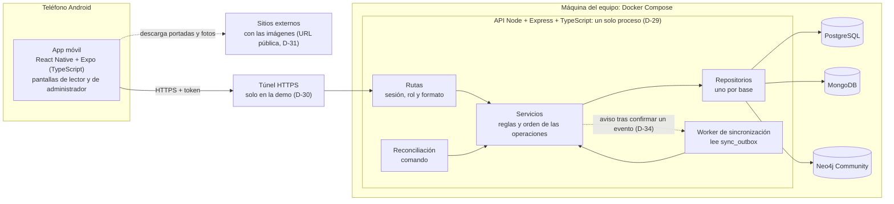
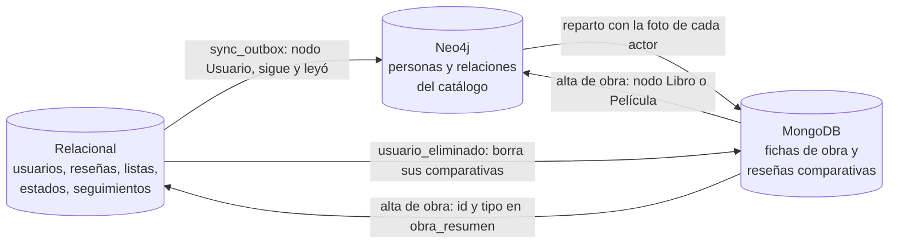

# Diagrama de arquitectura: Del Libro a la Pantalla

Muestra cómo se conectan la app, la API y las tres bases. Es un **borrador por escalones**: refleja D-28 a D-37 y el stack de `03-eleccion-stack.md`.

Las responsabilidades de cada pieza están en `02-responsabilidades.md`. Los datos que viven en más de una base y su sincronización, en `../modelado/fuente-de-verdad.md`.

## 1. Componentes

## 2. Qué viaja por cada flecha

| Flecha | Qué viaja | Quién la inicia |
|---|---|---|
| App → túnel → rutas | Peticiones HTTPS con el token de sesión. La dirección base de la API es configurable en la app, porque la del túnel puede cambiar (D-30) | El usuario, desde la app |
| App → sitios externos | Solo la descarga de las imágenes; las bases guardan la URL, no el archivo (D-25, D-31) | La app, al mostrar una ficha o una persona |
| Rutas → servicios | Datos ya validados de formato, junto con el `usuario_id` y el rol de la sesión | La API |
| Servicios → repositorios | Operaciones de lectura y escritura sobre una base concreta | Los servicios |
| Servicios → worker | Aviso en memoria, después de confirmar una transacción que escribió en `sync_outbox` (D-34) | Los servicios que generan eventos |
| Worker → servicios | Evento pendiente de `sync_outbox` para aplicarlo a las otras bases (O19) | El propio worker, al recibir un aviso o cada 30 s |
| Reconciliación → servicios | Comparación de la fuente contra la copia y corrección de la copia | Una persona, ejecutando el comando |
| Repositorios → bases | Consultas SQL, de MongoDB y de Cypher | Los repositorios |

## 3. Sincronización entre bases

Cada flecha va de la fuente de verdad a la copia. Es eventual y se reintenta (RNF-02).

## 4. Despliegue

| Pieza | Dónde corre | Nota |
|---|---|---|
| API | Contenedor `api` de Docker Compose | Una sola copia (D-29) |
| Relacional | Contenedor de PostgreSQL | D-33 |
| MongoDB | Contenedor | D-09 |
| Neo4j Community | Contenedor | D-14, D-22 |
| App | El teléfono real, con la app instalada | Solo Android (D-28) |
| Túnel | Cloudflare Tunnel o ngrok, en la máquina del equipo | Solo para la demo (D-30) |

No hay contenedor de imágenes: el administrador pega URLs públicas (D-31).

## 5. Lo que este diagrama aún no muestra

| Pendiente | Dónde se decide |
|---|---|
| Orden de construcción y calendario | `05-orden-de-construccion.md` |
| Parámetros exactos de memoria de cada contenedor y de Argon2id | Se ajustan al implementar (D-35, D-36) |
