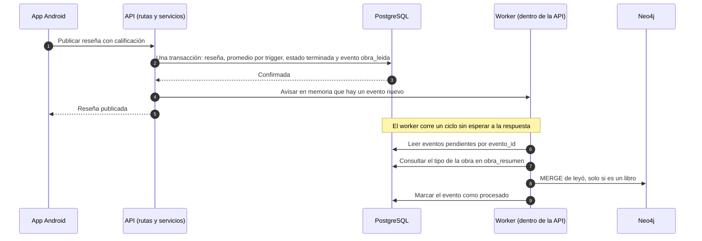
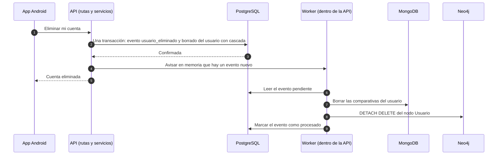
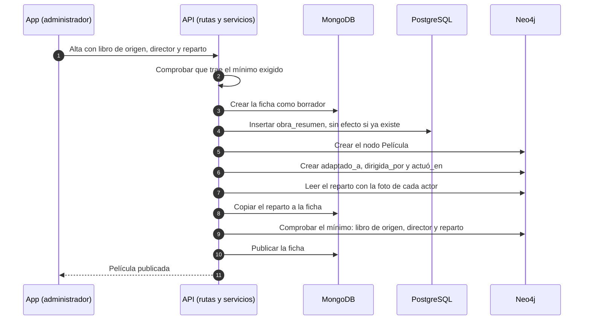

# Fuente de verdad y estrategia de sincronización

Resume en un solo lugar de qué base es cada dato y cómo viajan las copias entre bases, aplicado a la arquitectura elegida: una API Node con Express (D-32), PostgreSQL (D-33), MongoDB (D-09), Neo4j Community (D-14, D-22) y el worker dentro de la API (D-29).

**Este documento no repite el diseño de datos.** El análisis completo, con las alternativas evaluadas, está en `../modelado/fuente-de-verdad.md`; la matriz de responsabilidades, en `../modelado/matriz-responsabilidades.md`; y los eventos y operaciones, en `../modelado/relacional/04-operaciones.md`. Aquí se ve cómo se ejecuta todo eso en la arquitectura, y se fijan los detalles de implementación que faltaban (sección 9).

## 1. Principios

1. **Cada dato tiene una sola fuente de verdad.** Las copias existen para evitar consultas encadenadas y siempre se pueden reconstruir.
2. **Se escribe primero en la fuente y después en la copia**, con reintento si falla (RNF-02).
3. **Las copias nunca se editan directamente** (RNF-03). Solo las escribe el proceso de sincronización.
4. **Dentro de una base la operación es atómica; entre bases no** (RNF-01). Los fallos parciales se mitigan con reintento, la bandeja `sync_outbox`, fichas en `borrador` y el script de reconciliación.
5. **Toda propagación es idempotente.** Repetir un evento no duplica nada (`MERGE` en el grafo, reemplazo completo del reparto, inserción condicional en `obra_resumen`).
6. **La API es el único que escribe en las bases** y el único que sabe de las tres a la vez. La app nunca toca una base.

## 2. Fuente de verdad por dato

| Dato | Fuente de verdad | Quién lo modifica | Copias |
|---|---|---|---|
| Cuenta, credenciales, rol, perfil | PostgreSQL | Usuario; el rol de administrador, un script de carga inicial | Nodo `Usuario` en el grafo (solo `usuario_id`) |
| Reseñas, estados de obra, listas | PostgreSQL | Usuario; el administrador modera | `leyó` en el grafo (solo libros terminados) |
| Seguimiento entre usuarios | PostgreSQL (D-01) | Usuario | `sigue` en el grafo |
| Promedio y total de reseñas de una obra | PostgreSQL (`obra_resumen`) | Solo la transacción de reseña | Ninguna: es un dato derivado de la misma base |
| Título, sinopsis, portada, géneros, ediciones, plataformas, datos técnicos | MongoDB (ficha) | Administrador | Ninguna |
| Existencia e identificador de una obra | MongoDB (ficha) | Administrador | `obra_resumen` en PostgreSQL y nodo `Libro` o `Película` en el grafo |
| Reseña comparativa | MongoDB | Usuario; el administrador modera | Ninguna |
| Personas, su foto, autoría, dirección, reparto y adaptación | Neo4j | Administrador | Reparto con la foto de cada actor, copiado a la ficha de la película |

**Lo que no se replica por decisión** (`../modelado/fuente-de-verdad.md`, sección 4): la calificación de las reseñas fuera del relacional, el nombre y perfil del usuario fuera del relacional, los autores y directores fuera de la ficha, `adaptado_a` fuera del grafo, y la portada y el título fuera de la ficha (D-18, D-25).

## 3. Las siete copias y cómo se mantienen

La dirección de cada flecha se ve en `01-diagrama-arquitectura.md`, sección 3.

| # | Dato | Fuente → copia | Disparador | Mecanismo |
|---|---|---|---|---|
| 1 | Seguimiento | PostgreSQL → grafo (`sigue`) | RF-21 | Bandeja de salida (sección 4) |
| 2 | Estado de lectura de libros | PostgreSQL → grafo (`leyó`) | RF-13, RF-15 | Bandeja de salida |
| 3 | Identidad de usuario | PostgreSQL → grafo (nodo `Usuario`) | RF-01 | Bandeja de salida |
| 4 | Limpieza al eliminar la cuenta | PostgreSQL → MongoDB y grafo | RF-04 | Bandeja de salida |
| 5 | Existencia de obra | MongoDB → PostgreSQL (`obra_resumen`) y grafo (nodo) | RF-08 | Secuencia del alta (sección 5) |
| 6 | Reparto con la foto de cada actor | Neo4j → MongoDB (ficha) | RF-10, CG-24 | Regeneración (sección 6) |
| 7 | Promedio | Reseñas → `obra_resumen` | RF-13 | Trigger, misma base y misma transacción |

## 4. Bandeja de salida: de PostgreSQL a las otras bases

Es el mecanismo de las copias 1 a 4. El evento nace **en la misma transacción** que el dato, de modo que no puede existir uno sin el otro.

### 4.1 La tabla

`sync_outbox` (`../modelado/relacional/01-tablas-campos-llaves-relaciones.md`, sección 4.8): `evento_id` (orden de aplicación), `tipo_evento`, `payload` (ids y datos mínimos), `estado` (`pendiente`, `procesado` o `fallido`), `intentos`, `error`, `creado_en` y `procesado_en`.

### 4.2 Los eventos

| Evento | Lo genera | Efecto al procesarlo |
|---|---|---|
| `usuario_creado` | Registro | Neo4j: crea el nodo `Usuario` |
| `usuario_eliminado` | Eliminar cuenta | Neo4j: `DETACH DELETE` del nodo. MongoDB: borra las comparativas del usuario |
| `seguimiento_creado` | Seguir | Neo4j: crea `sigue` |
| `seguimiento_eliminado` | Dejar de seguir | Neo4j: borra `sigue` |
| `obra_leida` | Publicar reseña, marcar terminada | Neo4j: crea `leyó`, solo si la obra es un libro (D-16) |
| `obra_no_leida` | Quitar el estado terminada | Neo4j: borra `leyó`, solo si es un libro |

### 4.3 El worker

El worker corre **dentro de la API** (D-29) y es la única copia en ejecución (D-04). Se despierta por dos vías (9.1, D-34): un **aviso en memoria** cuando la API confirma un evento nuevo, y un **sondeo de respaldo cada 30 segundos**. Nunca hay dos ciclos a la vez. En cada ciclo hace lo que describe O19:

1. Toma un lote de eventos `pendiente`, ordenados por `evento_id` (lo sirve el índice I6, parcial sobre los pendientes).
2. Para cada uno, llama al servicio de Sincronización, que lo aplica a la base destino con una operación idempotente.
3. Si tiene éxito, lo marca `procesado` con su fecha.
4. Si falla, suma uno a `intentos` y guarda el `error`. Al llegar al límite (propuesto: 5), lo marca `fallido` y sigue con los demás.
5. Un evento `fallido` lo corrige la reconciliación y no bloquea a los otros.

Cada 30 días (valor propuesto) se purgan los eventos `procesado`, para mantener pequeño el índice (O21).

### 4.4 Por qué el orden no se rompe

- **Un solo proceso** aplica los eventos de uno en uno, así que "seguir" y "dejar de seguir" no pueden cruzarse por haberse procesado en paralelo.
- `evento_id` se asigna al insertar el evento, no al confirmar la transacción. Dos transacciones distintas podrían confirmarse en orden inverso a sus ids. Eso no importa, porque solo cuenta el orden de los eventos que afectan **al mismo dato**, y ese lo serializa el bloqueo de fila que las operaciones ya piden: el de `estado_obra` en O7 y O11, y el de la fila de `seguimiento` en O15 y O16. Comprobado el 2026-11-24 con operaciones simultáneas sobre un mismo seguimiento y un mismo estado (`backend/test/orden-eventos.test.ts`).
- Por la misma razón, si un evento falla el *worker* no pasa al siguiente: lo reintenta con la espera de 9.5 hasta que sale o queda `fallido`.

### 4.5 Ejemplo: publicar una reseña (RF-13)

Para la app, la reseña y el promedio ya son definitivos al responder la API. Lo único eventual es que la recomendación todavía no cuente esa lectura hasta que el worker aplique el evento.

### 4.6 Ejemplo: eliminar la cuenta (RF-04)

Entre la respuesta y el procesamiento del evento pueden quedar comparativas o un nodo huérfano. No se ven, porque la API los filtra contra el relacional (`../modelado/fuente-de-verdad.md`, sección 6).

## 5. Alta de una obra: de MongoDB a PostgreSQL y Neo4j

Es la copia 5. No usa la bandeja: la API ejecuta una **secuencia ordenada** y la ficha pasa de `borrador` a `publicada` al final (D-10, D-24). Mientras es borrador no se muestra en el catálogo.

Detalles que el diagrama no muestra:

- **Libro y película dependen uno del otro** (D-24). El alta de un libro termina en `borrador`, y el alta de su primera película lo publica antes de publicar a la película. Lo que cuenta es que exista la relación `adaptado_a`, no que el otro extremo ya esté publicado.
- **Si el alta se interrumpe**, la ficha queda en `borrador` y no se ve. La reconciliación repite los pasos que faltan, que son idempotentes. Si faltan datos que solo el administrador conoce (el autor, el director, un actor o el libro), no la publica y la reporta.
- **Para la película, el administrador registra personas antes.** CG-02 permite buscar una persona existente antes de crear otra y evitar duplicados (D-15).
- **RN-07** (un solo libro de origen) se protege bloqueando antes el nodo de la película al registrar `adaptado_a` (D-23).

## 6. Reparto con la foto: de Neo4j a MongoDB

Es la copia 6. La ficha de película guarda una copia del reparto (`persona_id`, `nombre`, `personaje`, `orden` y `foto_url` opcional, D-12 y D-27) para que la ficha se lea de una sola vez (RNF-04).

| Cuándo se regenera | Cómo |
|---|---|
| Al registrar o cambiar el reparto (RF-10) | La API escribe `actuó_en`, lee el reparto con CG-20 y reemplaza el arreglo completo con AP-17 |
| Al cambiar la foto de una persona (CG-24) | La API escribe la foto en el nodo, obtiene las películas donde actuó con CG-25 y regenera el reparto de cada una |
| Durante la reconciliación | Compara con CG-21 y AP-32, y regenera lo que difiera |

Si falla la regeneración, el grafo queda correcto y la ficha muestra el reparto o la foto anteriores hasta que se reintente o la reconciliación la corrija.

## 7. Qué pasa si algo falla a medias

Dentro de una base, un fallo deshace toda la operación. Los fallos parciales solo existen entre bases.

| Operación | Si falla | Qué se ve | Política |
|---|---|---|---|
| Publicar reseña | La transacción en PostgreSQL | Nada cambió | Rollback; el usuario reintenta |
| Publicar reseña | Falla la propagación a `leyó` | Reseña y promedio correctos; la recomendación aún no cuenta esa lectura | Reintento desde `sync_outbox`; si se agota, `fallido` y reconciliación |
| Seguir a un usuario | Falla la escritura de `sigue` | El seguimiento es válido; sin efecto en las recomendaciones | Igual que arriba |
| Alta de obra | Falla tras crear la ficha | La ficha queda en `borrador` y no se muestra | La reconciliación completa los pasos que faltan; no elimina nada |
| Reparto o foto | Falla la regeneración de la ficha | El grafo es correcto; la ficha está desactualizada | Reintento y reconciliación |
| Eliminar la cuenta | Falla la limpieza en MongoDB o Neo4j | La cuenta ya no existe; quedan restos que la API oculta | Reintento; la reconciliación busca huérfanos |
| Crear una comparativa | Neo4j no responde al comprobar la adaptación | No se crea | Se rechaza con un error recuperable; no se guarda nada |

## 8. Reconciliación

Es un comando del mismo código (D-29) que compara la fuente con la copia y corrige solo la copia. Su lista completa está en `../modelado/fuente-de-verdad.md`, sección 6. En resumen:

| # | Qué compara o hace |
|---|---|
| 1 | `seguimiento` contra `sigue` |
| 2 | `estado_obra` terminada de libros contra `leyó` |
| 3 | Ids y tipo de las fichas publicadas contra `obra_resumen` y los nodos; reporta las obras publicadas que no llegan al mínimo (D-24) |
| 4 | `actuó_en` y la foto de la persona contra el `reparto` de la ficha |
| 5 | `promedio` y `total_resenas` contra el recálculo desde las reseñas |
| 6 | Huérfanos: usuarios y obras que existen en una copia y no en su fuente |
| 7 | Eventos `fallido` en `sync_outbox` |
| 8 | Fichas en `borrador` antiguas: repite los pasos que faltan, nunca las elimina |
| 9 | Nombres de persona repetidos: solo los reporta, porque puede haber homónimos (D-15) |

Lo que **no** hace: no inventa datos (la persona que falta), no fusiona personas y no edita la fuente, salvo publicar una ficha que ya tiene todo lo necesario.

## 9. Decisiones de implementación

Los documentos de modelado fijan el qué. Estos detalles de cómo faltaban. Todos están aprobados. Se revisaron también por su costo de rendimiento, y ninguno es costoso en el volumen del proyecto.

### 9.1 Cómo se entera el worker de que hay eventos nuevos (aprobado, D-34)

**Aviso dentro del proceso, con un sondeo de respaldo lento.**

- **Aviso.** Cuando una operación confirma una transacción que escribió en `sync_outbox`, el servicio avisa al worker en memoria (por ejemplo, con un `EventEmitter`). El aviso se envía **después** de confirmar, nunca antes. El worker corre un ciclo y el cambio llega a las otras bases en milisegundos.
- **Respaldo.** Además, el worker consulta la bandeja cada 30 segundos. Cubre los eventos que ya estaban pendientes cuando se reinició la API (no había aviso) y cualquier aviso que se pierda.
- **Nunca dos ciclos a la vez.** Si llega un aviso mientras corre un ciclo, al terminar se ejecuta otro. Así no se pierde ningún aviso y se respeta el proceso único de D-04.
- **Índice parcial.** En PostgreSQL, I6 se crea solo sobre los eventos `pendiente` (`../modelado/relacional/03-indices.md`). Con la bandeja casi vacía, cada consulta recorre un índice vacío y cuesta casi nada, aunque la tabla acumule eventos procesados.

| Opción considerada | Consultas al día en reposo | Latencia | Veredicto |
|---|---|---|---|
| Sondeo fijo cada 2 s | ~43 200 | Hasta 2 s | Descartada: la más costosa en reposo |
| Sondeo adaptativo | ~3 000 a 9 000 | Hasta 30 s tras un rato inactivo | Descartada: mala para la demo |
| `LISTEN/NOTIFY` + sondeo de respaldo | ~1 000 a 3 000 | Milisegundos | Reserva, si el worker se separa de la API |
| **Aviso en el proceso + sondeo de 30 s** | **~2 900** | **Milisegundos** | **Elegida** |
| Leer el log de PostgreSQL (Debezium) o colas ya hechas (pg-boss, BullMQ) | Variable | Milisegundos | Descartada: componentes y memoria extra, y modelos pensados para trabajos independientes, no para eventos ordenados |

**Límite.** El aviso solo funciona mientras la API y el worker sean el mismo proceso (D-29). Si algún día se separan, se reemplaza por `LISTEN/NOTIFY` y se mantiene el sondeo de respaldo.

### 9.2 Tamaño del lote (aprobado: 50 eventos por ciclo)

Si el worker estuvo parado (la API reiniciada), puede haber cientos de eventos acumulados. Procesarlos por lotes evita una consulta enorme y una transacción larga. Si el lote salió lleno, el worker procesa el siguiente sin esperar. Cada evento son unas pocas operaciones cortas, así que un lote tarda del orden de un segundo (estimado, sin medir).

### 9.3 Qué hace al arrancar (aprobado: vaciar primero lo pendiente)

Al arrancar la API, el worker procesa de inmediato lo que quedó pendiente. Con el aviso en memoria (9.1), esto **es necesario**: un reinicio no genera avisos, y este vaciado, junto con el sondeo de 30 s, es lo que recoge los eventos pendientes. Además, la API **no debe fallar al arrancar si Neo4j todavía no está listo**: Neo4j tarda en levantar y Docker Compose no espera a que esté disponible. El worker espera y reintenta en lugar de abortar.

### 9.4 Apagado ordenado (aprobado: terminar el evento en curso)

Al recibir la señal de apagado, el worker termina el evento que está aplicando y no toma otro. Aunque lo matasen a la mitad, no se corrompe nada: si Neo4j aplicó el `MERGE` de `leyó` pero el evento no llegó a marcarse `procesado`, se aplica de nuevo al reiniciar y no duplica la relación. Docker espera un tiempo limitado (10 s por defecto) antes de forzar el cierre. Sin costo de rendimiento.

### 9.5 Qué hacer si una base destino está caída (aprobado: pausar sin contar intentos)

Con 5 intentos, un reinicio de Neo4j de un minuto bastaría para marcar como `fallido` muchos eventos buenos, y entonces sus relaciones tendrían que esperar a la reconciliación. Se distinguen dos casos:

- **El destino no responde** (error de conexión): el worker pausa y reintenta con espera creciente (2, 4, 8… hasta un tope de 30 s) **sin sumar intentos**. Cuando el destino vuelve, continúa en orden.
- **El evento falla por sí mismo** (por ejemplo, apunta a una obra que no existe en el grafo): suma intentos y, al quinto, queda `fallido`.

Esto reduce la carga durante una caída, en vez de reintentar cada evento varias veces seguidas. Para las escrituras en Neo4j conviene usar las transacciones administradas del driver (`executeWrite`), que reintentan solas los errores transitorios, con un tope por defecto que se debe comprobar al implementar. No choca con D-23: el bloqueo del nodo de la película va dentro de la misma transacción.

### 9.6 Cuándo se ejecuta la reconciliación (aprobado: a mano)

Un comando que se lanza con una orden, por ejemplo antes de la demo, para comprobar que los datos de prueba están completos y las copias coinciden. No se programa en segundo plano, porque un script que corrige datos mientras la app se usa complica el diagnóstico y el plazo no lo justifica. Recorre colecciones completas, así que debe leer por lotes (CG-21, CG-22 y CG-23 ya lo son) y no cargar todo en memoria, y no se ejecuta durante la demo. Se puede automatizar después sin cambiar el diseño.

### 9.7 Identificadores (aprobado)

PostgreSQL entrega los UUID en minúsculas y con guiones, que es el formato que exige D-11 para las tres bases. Aun así, la API los normaliza y los valida al entrar, porque el validador de MongoDB rechaza mayúsculas (`../modelado/documental/04-validacion.md`) y, en Neo4j, un id en mayúsculas es un texto distinto del mismo id en minúsculas. *(Comprobar con una prueba al implementar.)*

### 9.8 Resumen de estado

| # | Detalle | Estado |
|---|---|---|
| 9.1 | Aviso en el proceso y sondeo de respaldo de 30 s; I6 parcial | Aprobado (D-34) |
| 9.2 | Lotes de 50 | Aprobado |
| 9.3 | Vaciar lo pendiente al arrancar y no fallar si Neo4j no está listo | Aprobado |
| 9.4 | Apagado ordenado | Aprobado |
| 9.5 | Pausa con espera creciente sin contar intentos | Aprobado |
| 9.6 | Reconciliación a mano | Aprobado |
| 9.7 | Ids normalizados a minúsculas | Aprobado |

## 10. Lo que este documento no cubre

| Tema | Dónde está |
|---|---|
| Por qué cada dato vive donde vive, con las alternativas evaluadas | `../modelado/fuente-de-verdad.md`, sección 2 |
| Los patrones de acceso de MongoDB y las consultas de Neo4j (AP-xx, CG-xx) | `../modelado/documental/` y `../modelado/grafo/` |
| Autenticación y vida del token | `03-eleccion-stack.md`, sección 8 |
| Orden de construcción para el plazo del proyecto | Escalón siguiente |
