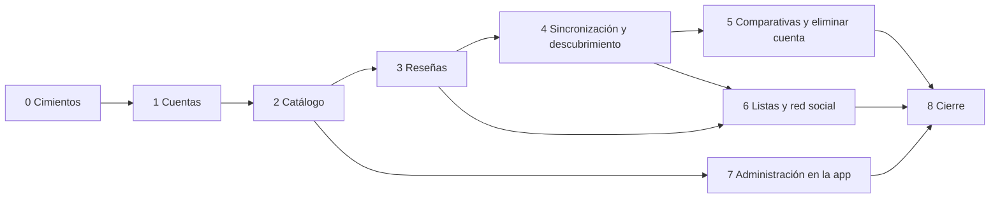

# Orden de construcción

Propone en qué orden construir la aplicación para llegar a la demo con algo que funcione, aunque no alcance el tiempo para todo. Es un **borrador**: el calendario con las horas disponibles está en la sección 7. Las piezas están en `01-diagrama-arquitectura.md`, su reparto en `02-responsabilidades.md`, el stack en `03-eleccion-stack.md` y la sincronización en `04-fuente-de-verdad-y-sincronizacion.md`.

Se asume una sola persona desarrolladora y una máquina de 6 GB de RAM compartida con otros proyectos.

## 1. Criterios del orden

1. **Rebanadas verticales.** Cada bloque construye una función completa, de la pantalla del teléfono a las bases. No se hace "primero todo el servidor y luego la app", porque los errores de integración aparecerían al final.
2. **Esqueleto andante primero.** Lo más arriesgado no es una regla de negocio sino la cadena entera: teléfono → túnel HTTPS → API → bases. Se prueba el primer día con una pantalla mínima.
3. **Lo que justifica las tres bases se construye antes que lo accesorio.** El proyecto debe demostrar el relacional (transacción de reseña, cascada), el documental (ficha anidada, comparativa) y el grafo (camino y recomendaciones), más la sincronización. Las listas, por ejemplo, son un CRUD relacional sin nada que demostrar.
4. **Los datos de prueba pronto.** Los recorridos del grafo (RF-24 a RF-27) no se pueden probar sin cadenas de adaptaciones y repartos compartidos (RNF-10). La semilla se escribe en el bloque 2, no al final.
5. **Los eventos se escriben desde el principio y el worker llega después.** `sync_outbox` acumula los eventos desde el bloque 1. Cuando el worker se construya (bloque 4), vacía los pendientes por orden de `evento_id`, así que no se pierde nada.
6. **La administración en la app va casi al final.** Es lo menos vistoso. Mientras tanto, el alta de obras se hace con un script que usa el mismo servicio de Administración, de modo que ese servicio queda probado antes de ponerle pantallas.
7. **Siempre hay una versión que demuestra algo.** Al terminar cada bloque, la app corre en el teléfono y las pruebas del bloque pasan antes de empezar el siguiente.

## 2. Los bloques

Tamaño relativo, no en días: **S** pequeño, **M** mediano, **L** grande.

| Bloque | Qué se construye | Requerimientos | Base que luce | Tamaño |
|---|---|---|---|---|
| 0. Cimientos y esqueleto andante | Docker Compose con las tres bases y límites de memoria. Repositorio con `api/`, `app/` y una carpeta compartida de esquemas. Esquemas de las tres bases (tablas, validadores, índices, restricciones). API con sus tres capas, manejo de errores y configuración. Túnel HTTPS. La app abre en el teléfono real y llama a una ruta de salud | RNF-09, D-28 a D-31 | — | M |
| 1. Cuentas y sesión | Registro, inicio y cierre de sesión, perfil. Rol de administrador por script. Eventos `usuario_creado` en la bandeja | RF-01, RF-02, RF-03 | Relacional | S |
| 2. Catálogo | Servicio de Administración con alta de libros, películas, personas y adaptaciones (flujo de borrador a publicada, D-24), usado por un script. **Semilla** con cadenas de adaptaciones y repartos compartidos. Lectura: búsqueda por título, ficha con reparto, adaptaciones. Pantallas de búsqueda y ficha | RF-05 (título), RF-06, RF-07, RF-08, RF-10, RF-11 y RF-23 (sin pantallas de administración) | Documental, grafo | L |
| 3. Reseñas y estados | Publicar reseña con la transacción única (reseña, promedio por trigger, estado, evento), editar y eliminar, marcar estado. El promedio aparece en la ficha. Pantalla de reseña | RF-12 a RF-15 | Relacional | M |
| 4. Sincronización y descubrimiento | Worker con aviso en memoria y sondeo de respaldo (D-34), pausa si Neo4j no responde. Seguir y dejar de seguir. Búsqueda por persona. Camino entre dos nodos, autores del mismo director, recomendaciones de libros y de películas. Pantallas de explorar y recomendaciones | RF-05 (persona), RF-21, RF-24 a RF-27 | Grafo, sincronización | L |
| 5. Comparativas y eliminar cuenta | Reseña comparativa con validación de la adaptación contra el grafo. Eliminar cuenta con cascada y limpieza en MongoDB y Neo4j por el worker | RF-16, RF-17, RF-04 | Documental, integridad entre bases | M |
| 6. Listas y red social | Listas y sus elementos ordenados. Ver perfiles, reseñas y listas de los seguidos | RF-19, RF-20, RF-22 | Relacional | M |
| 7. Administración en la app | Pantallas de alta y corrección de obras, personas, adaptaciones, ediciones, plataformas, fotos por URL y moderación | RF-08 a RF-11 (pantallas), RF-09, RF-18 | Las tres | L |
| 8. Cierre | Comando de reconciliación. Pruebas de integridad de los documentos. APK de prueba. Ensayo completo de la demo con el teléfono real | RNF-03 | — | S a M |

Todos los RF aparecen en algún bloque. El bloque 0 no es opcional, y el 8 tampoco.

### Dependencias

El 7 solo depende del 2 porque reutiliza el servicio de Administración, y el 6 necesita el 4 para ver a los seguidos. Si hay que recortar, el 6 y el 7 se pueden intercambiar de orden.

### Por qué este orden

- **El catálogo va antes que las reseñas.** `resena` tiene llave foránea hacia `obra_resumen`, y esa fila nace en el alta de la obra (O5), así que sin catálogo no hay a qué reseñar.
- **El catálogo toca las tres bases desde el principio.** Para publicar una ficha hace falta que el grafo tenga sus relaciones mínimas (D-24). Por eso el alta es lo más largo del bloque 2 y se hace por script, sin pantallas.
- **El grafo y el worker van juntos.** Sin worker no existen `sigue` ni `leyó`, y sin ellos RF-26 y RF-27 no devuelven nada.

## 3. Qué demuestra cada corte

| Hasta el bloque | Qué se puede enseñar | Qué falta |
|---|---|---|
| 3 | Cuentas, catálogo con ficha anidada, reseñas con promedio exacto. Relacional y documental funcionando | El grafo y la sincronización |
| **4 (demo mínima)** | Lo anterior, más el camino entre un autor y un actor, y las recomendaciones por seguidos. Las tres bases y la bandeja funcionando juntas | Comparativas, eliminar cuenta, listas, administración en pantalla |
| 5 (demo completa de bases) | Lo anterior, más la reseña comparativa como objeto propio y la eliminación de cuenta que limpia las tres bases | Listas, red social, administración en pantalla |
| 8 | Todo lo que el plazo permita, con el cierre hecho | — |

**Línea de corte recomendada: no abandonar nada antes del bloque 4.** Del 5 en adelante el orden de recorte, del primero al último, es:

1. Listas (RF-19, RF-20).
2. Ver perfiles, reseñas y listas de los seguidos (RF-22).
3. Pantallas de administración (bloque 7): las operaciones siguen existiendo por script o por llamadas HTTP, pero **RF-08 a RF-11 y RF-18 pedirían entonces una app que no las ofrece**, y eso se tendría que declarar como alcance recortado.
4. Editar y eliminar comparativas (RF-17).
5. Reseña comparativa y eliminar cuenta (bloque 5): se recortan al final porque justifican el documental y el relacional.

## 4. Autenticación (decidida, D-35)

Se eligió la sesión guardada en PostgreSQL. El bloque 1 la implementa así:

- **Contraseñas** con un hash lento de buena práctica (RNF-06): propuesto Argon2id, o bcrypt si la instalación da problemas. Los parámetros se confirman al implementar.
- **Inicio de sesión (O2):** la API genera un token aleatorio de 32 bytes, guarda en `sesion` solo su hash SHA-256 y entrega el token a la app una sola vez. Vence a los 30 días y no se renueva.
- **Cada petición (O22):** la API busca la sesión unida con el usuario por clave primaria. Eso confirma que sigue vigente y trae el rol actual, así que un cambio de rol surte efecto al instante.
- **Cerrar sesión (O23):** se borra la fila. **Eliminar la cuenta (RF-04)** las borra todas por la cascada, sin código extra.
- **App:** guarda el token en el almacenamiento seguro del teléfono y lo envía en cada petición.

**Costo que se acepta:** una tabla más y una consulta por clave por petición. Un token robado sirve hasta que se cierre la sesión o venza, pero se puede revocar borrando la fila.

## 5. Prácticas durante la construcción

| Práctica | Por qué |
|---|---|
| Probar cada ruta con peticiones HTTP antes de hacer la pantalla | Separa los fallos de la API de los de la interfaz |
| Convertir las pruebas de los documentos de modelado en pruebas automáticas, bloque a bloque | Ya están escritas: rollback de la transacción de reseña, cascada, promedio, comparativa duplicada, cardinalidad de adaptación |
| Escribir primero la prueba de concurrencia del orden de eventos (`04`, sección 4.4) | Es la hipótesis menos verificada del diseño |
| Una confirmación de código y una etiqueta al cerrar cada bloque | Si algo se rompe en el siguiente, hay a dónde volver |
| Compilar el APK al terminar el bloque 4, no el último día | Descubrir un problema de compilación en la última hora arruinaría la demo |
| Levantar solo los contenedores del bloque en curso y no lanzar pruebas que abran muchas JVM a la vez | La máquina tiene 6 GB y Neo4j es la pieza más pesada |
| Reservar al menos el último 15 a 20 % del tiempo para el bloque 8 y un margen | El ensayo siempre encuentra algo |

## 6. Riesgos específicos del orden

| Riesgo | Efecto | Mitigación |
|---|---|---|
| El esqueleto andante falla por HTTPS o por el túnel | Se pierde un día entero tarde | Probarlo en el bloque 0, con una pantalla mínima |
| El alta con las tres bases resulta más lenta de lo previsto | Retrasa catálogo, reseñas y todo lo demás | Cargar la semilla por script con el mismo servicio y no construir pantallas de administración hasta el bloque 7 |
| Datos de prueba que no forman caminos de varios saltos | RF-24 a RF-27 devuelven vacío en la demo y parecen rotos | Diseñar la semilla con cadenas y repartos compartidos desde el bloque 2 (RNF-10) |
| Sincronización con eventos acumulados raros | `sigue` o `leyó` incorrectos | La reconciliación del bloque 8 y la prueba de orden |
| Cambios de alcance a mitad del trabajo | Bloques a medias | Cerrar cada bloque antes del siguiente y aplicar la lista de recorte de la sección 3 |

## 7. Calendario

**Objetivo declarado:** la aplicación **completa** (los 27 requerimientos funcionales), no solo la demo mínima. La lista de recorte de la sección 3 queda como plan de contingencia.

**Supuestos (a confirmar):** hoy es lunes 23 de noviembre y la demo debe estar **lista el jueves 26 por la noche**, para dejar el viernes 27 solo como margen, sin trabajo nuevo. Una sola persona, con unas 5 horas lo que queda de hoy, 8 el martes y unas 10 el miércoles y el jueves.

### 7.1 Horas por bloque

Las horas son un juicio mío, no una medición. Suponen código escrito con ayuda de IA y **no incluyen imprevistos ni depuración larga**, que casi siempre ocurren.

| Bloque | Horas estimadas | Acumulado | Capacidad acumulada | Dónde cae |
|---|---|---|---|---|
| 0. Cimientos | 4 | 4 | Lunes: 5 | Lunes |
| 1. Cuentas y sesión | 2,5 | 6,5 | | Termina el martes temprano |
| 2. Catálogo | 6 | 12,5 | Martes: 13 | Martes |
| 3. Reseñas y estados | 4 | 16,5 | | Miércoles temprano |
| 4. Sincronización y descubrimiento | 6 | 22,5 | Miércoles: 23 | Miércoles |
| 5. Comparativas y eliminar cuenta | 4 | 26,5 | | Jueves temprano |
| 6. Listas y red social | 4 | 30,5 | | Jueves |
| 7. Administración en la app | 6 | 36,5 | Jueves: 33 | **Solo cabe en parte** |
| 8. Cierre | 3 | 39,5 | | **No cabe** |

**Resultado:** hacen falta unas 39,5 horas y hay unas 33 hasta el jueves por la noche. Faltan unas **6,5 horas**, sin margen para imprevistos. Los bloques 0 a 6 caben; el 7 solo en parte y el 8 no.

### 7.2 Cómo cerrar la diferencia

| Medida | Efecto | Costo |
|---|---|---|
| Pantallas de administración con formularios genéricos reutilizables | Ahorra unas 2 h en el bloque 7 | Menos diseño propio en esas pantallas |
| Reconciliación mínima (solo los puntos 1, 2, 5 y 8 de `04`, sección 8) | Ahorra cerca de 1 h en el bloque 8 | Cubre menos de RNF-03 |
| Horas extra: unas 3,5 h más entre el miércoles y el jueves (por ejemplo, 12 h el jueves) | Añade unas 3,5 h | Cansancio y más riesgo de errores a última hora |
| Recortar listas y ver a los seguidos (bloque 6) | Ahorra unas 4 h | RF-19, RF-20 y RF-22 quedan sin cubrir |

Con las dos primeras medidas faltan todavía unas 3,5 h, que se cubren con horas extra o recortando el bloque 6. Aun así **no hay margen real** para imprevistos: completar los 27 requerimientos antes del jueves por la noche solo es posible si casi todo sale a la primera. Lo prudente es decidir en el punto de control del miércoles.

### 7.3 Puntos de control

| Cuándo | Qué debe estar hecho | Si no está |
|---|---|---|
| Fin del lunes | Bloque 0 y el teléfono llamando a la API por el túnel | Resolver esto antes de seguir: todo depende de ello |
| Fin del martes | Bloques 1 y 2 | Aplicar la medida del bloque 7 desde ya |
| Fin del miércoles | Bloques 3 y 4 | Si el 4 no está, recortar el bloque 6 de inmediato |
| Jueves a mediodía | Bloque 5 terminado y el 6 avanzado | Decidir si se recorta el 6 |
| Últimas 3 horas del jueves | Solo el bloque 8: APK, reconciliación y ensayo con el teléfono real | No añadir nada nuevo, aunque el bloque 7 esté incompleto |
| Viernes | Margen para corregir lo que muestre el ensayo | Sin funciones nuevas |

## 8. Pendiente para completar este documento

| Dato | Para qué |
|---|---|
| Si las 10 h del miércoles y el jueves son realistas, y cuántas horas quedan hoy | Ajustar el calendario |
| Si la demo del jueves por la noche debe incluir los 27 requerimientos o se acepta recortar el bloque 6 | Decidir en el punto de control del miércoles |
| Cuántas horas hay el viernes antes de entregar | Ver cuánto de lo que se redacta sobre lo ya construido (sección 9.3) cabe ese día |

**Resuelto:** los entregables 4 a 8 vencen todos el viernes 27. La demo debe estar lista el jueves por la noche, para que el viernes quede solo como margen y para terminar documentos.

## 9. Los entregables del curso y los bloques

| Entregable | Qué pide (resumen) | Bloques que lo cubren | Qué falta en el calendario |
|---|---|---|---|
| 4. Implementación de las tres bases | Esquemas, scripts de creación y carga, pruebas, reconstrucción desde cero | Bloque 0 y la semilla del bloque 2 | Más que las 4 h del bloque 0: ver `../entregables/entregable-4-brief.md` |
| 5. Catálogo de operaciones y consultas | Cada operación con propósito, bases, parámetros, resultados, casos normales, límite y error, y evidencia de ejecución | Sale de las pruebas del entregable 4 y de los bloques 2 a 5 | La redacción del catálogo |
| 6. Backend y API | API REST o GraphQL con decisión justificada, capas separadas, drivers oficiales, validación, errores, autorización, consultas parametrizadas y contrato documentado | Bloques 1 a 6 | La justificación de REST frente a GraphQL y el contrato de la API (por ejemplo, con OpenAPI) |
| 7. Aplicación e integración | Interfaz funcional para los usuarios definidos, flujos con cada base, un caso integrado y evidencia de la consistencia | Bloques 1 a 7 | Modo visitante y la evidencia de consistencia (9.1) |
| 8. Pruebas, documentación y despliegue | Pruebas unitarias, por base, de integración, funcionales, de errores y consistencia; rendimiento; instalación; variables de ejemplo; repositorio | Bloque 8, muy ampliado | No está dimensionado: ver 9.2 |

### 9.1 Consecuencias para el diseño

- **Modo visitante (A3).** El catálogo (RF-05 a RF-07, RF-23) lo ve quien no tiene sesión, así que esas rutas de la API son públicas y la app debe abrir sin iniciar sesión.
- **Caso integrado.** Propuesta: *seguir a un lector y ver recomendaciones de películas* (RF-21 y RF-27). Toca PostgreSQL (el seguimiento), el grafo (`sigue` y `leyó` tras el worker) y MongoDB (las fichas que se muestran). Un segundo caso es el alta de una película, que recorre las tres bases.
- **Evidencia de consistencia.** El entregable 7 pide mostrar que los cambios se reflejan conforme a la estrategia definida (sincronización eventual). La forma más barata de hacerla visible es una **pantalla o ruta de administración con el estado de `sync_outbox`** (pendientes, procesados, fallidos). Costo estimado: cerca de 1 h. La alternativa son capturas de las bases y de los registros.
- **Repositorio.** El entregable 8 pide un repositorio de código y una demostración funcional, así que hay que inicializar git (hoy la carpeta no es un repositorio).
- **Que otra persona pueda ejecutarlo.** Instrucciones para el Compose, variables de ejemplo (`.env.example`) y cómo instalar la app en Android, con el APK o con Expo Go.

### 9.2 Trabajo del entregable 8 que el calendario no cuenta

Son estimaciones mías, sin medir. Parte se puede escribir mientras se construye cada bloque.

| Trabajo | Horas estimadas |
|---|---|
| Pruebas unitarias de los servicios principales | 2 |
| Pruebas de integración de la API con las bases (reutilizando las del entregable 4) | 2 |
| Pruebas de errores y de consistencia entre bases | 1 |
| Evaluación básica de rendimiento con condiciones documentadas | 1,5 |
| Documentación de instalación, configuración, carga y ejecución | 1,5 |
| **Total** | **~8** |

Sumadas a las 6,5 h que ya faltaban en la sección 7, **la diferencia hasta el jueves por la noche sería de unas 14 h**, si todos los entregables vencieran ese día. Como todos vencen el viernes, la diferencia no desaparece: solo se puede **repartir** entre el jueves por la noche y el viernes (9.3).

### 9.3 Reparto propuesto entre el jueves y el viernes

| Cuándo | Qué se hace | Por qué ahí |
|---|---|---|
| Hasta el jueves por la noche | Los bloques 0 a 5 (más el 6 y el 7 si caben), las pruebas escritas junto a cada bloque y el APK instalado en el teléfono | La aplicación funcionando es lo que no se puede improvisar el último día |
| El viernes, antes de entregar | Lo que se redacta sobre lo ya construido: el catálogo de operaciones (entregable 5), la justificación de REST frente a GraphQL y el contrato de la API (6), el README de instalación y la evaluación de rendimiento (8), y las capturas de la evidencia | Son documentos y mediciones que dependen de que el sistema ya corra |

No se contó cuántas horas hay el viernes ni cuánto tarda cada documento, así que este reparto es una propuesta, no un cálculo.
