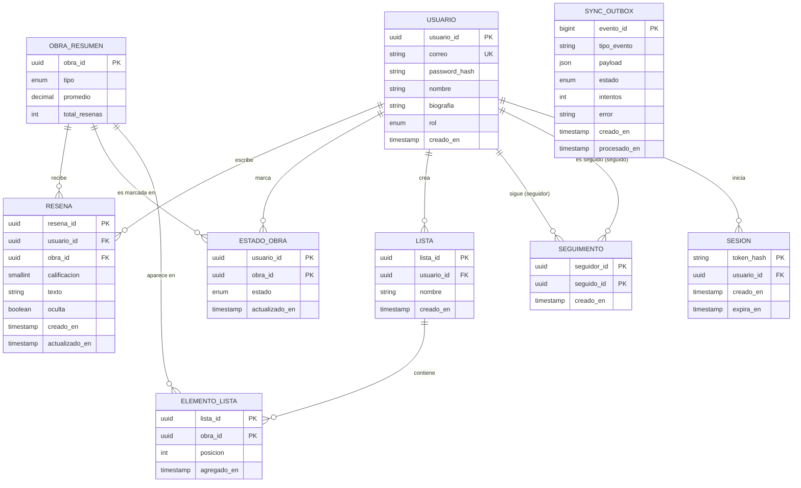

# Relacional, paso 1: tablas, campos, llaves y relaciones

Describe la estructura de la base relacional de *Del Libro a la Pantalla*. Las reglas de integridad (CHECK, UNIQUE, acciones de cascada, trigger) están en `02-restricciones-integridad.md`; los índices en `03-indices.md`; las operaciones en `04-operaciones.md`.

Parte de `../matriz-responsabilidades.md` (columna Relacional) y `../fuente-de-verdad.md`.

## 1. Qué guarda esta base

Es la fuente de verdad de usuarios, reseñas, estados de lectura, listas, seguimientos y del promedio de cada obra. No guarda los datos descriptivos de las obras (están en el documental) ni las conexiones entre autores, directores y actores (están en el grafo).

| Tabla | Qué representa | Requerimientos |
|---|---|---|
| `usuario` | Cuenta, credenciales, perfil y rol | RF-01 a RF-04 |
| `obra_resumen` | Referencia local de cada obra y su promedio de calificación | RF-08, RF-13 |
| `resena` | Calificación y texto de un usuario sobre una obra | RF-12 a RF-14, RF-18 |
| `estado_obra` | Estado de un usuario respecto a una obra | RF-13, RF-15 |
| `lista` | Lista personalizada de un usuario | RF-19 |
| `elemento_lista` | Obra dentro de una lista, con su posición | RF-20 |
| `seguimiento` | Relación "usuario sigue a usuario" | RF-21 |
| `sync_outbox` | Cola técnica de cambios por propagar al grafo | RNF-02 |
| `sesion` | Sesión iniciada por un usuario; guarda solo el hash de su token | RF-02, D-35 |

## 2. Diagrama entidad-relación

`sync_outbox` no se relaciona con ninguna tabla a propósito: es infraestructura, no dominio.

## 3. Decisiones de estructura

| Decisión | Elegido | Por qué |
|---|---|---|
| Tipo de identificador | `UUID` generado por la aplicación | RNF-08 exige los mismos ids en las tres bases; un UUID existe antes de escribir en cualquiera de ellas y no depende de un contador del relacional. |
| Rol del usuario | Columna `rol` de tipo ENUM en `usuario` | Solo hay dos roles (lector y administrador); una tabla de roles no aporta nada. |
| Dominios cerrados | Tipo ENUM en `usuario.rol`, `obra_resumen.tipo`, `estado_obra.estado` y `sync_outbox.estado` | El motor valida el valor y lo guarda en menos espacio que un texto. `sync_outbox.tipo_evento` queda como texto con CHECK porque su lista de valores puede crecer. |
| Obras en el relacional | Tabla mínima `obra_resumen`, sin datos descriptivos | Permite claves foráneas desde reseñas, estados y listas, y da un lugar al promedio, sin duplicar la ficha documental (ver `../fuente-de-verdad.md`, D1 y D2). |
| Reseña oculta | Columna `oculta` en `resena`, sin borrar | RF-18 permite ocultar; el promedio solo cuenta las no ocultas. |
| Orden de los eventos | `evento_id` autoincremental en `sync_outbox` | Seguir y dejar de seguir deben aplicarse al grafo en el mismo orden en que ocurrieron. |
| Identificadores compuestos | `estado_obra`, `elemento_lista` y `seguimiento` usan clave primaria compuesta | La clave compuesta ya expresa que existe un solo registro por par; no necesitan id propio. |
| Sesión | Tabla `sesion` con un token aleatorio del que solo se guarda el hash (D-35) | Permite cerrar sesión de verdad y que la cascada de RF-04 la invalide sola. El token en claro nunca se guarda. |

## 4. Tablas y campos

Notación: **PK** clave primaria, **FK** clave foránea, **UK** única. Los valores permitidos de los campos enumerados se listan aquí; su validación formal está en el paso 2.

### 4.1 `usuario`

| Campo | Tipo | Nulo | Clave | Descripción |
|---|---|---|---|---|
| `usuario_id` | UUID | No | PK | Identificador del usuario, compartido con el grafo y el documental |
| `correo` | VARCHAR(254) | No | UK | Correo de inicio de sesión (RF-01). Se guarda siempre en minúsculas |
| `password_hash` | VARCHAR(255) | No | | Hash de la contraseña; nunca se guarda en claro (RNF-06) |
| `nombre` | VARCHAR(100) | No | | Nombre visible (RF-03) |
| `biografia` | VARCHAR(500) | Sí | | Biografía breve (RF-03) |
| `rol` | ENUM('lector','admin') | No | | `lector` (por defecto) o `admin` |
| `creado_en` | TIMESTAMP | No | | Fecha de registro |

### 4.2 `obra_resumen`

Se crea en el alta de la obra (RF-08). El id es el mismo de la ficha documental y del nodo del grafo.

| Campo | Tipo | Nulo | Clave | Descripción |
|---|---|---|---|---|
| `obra_id` | UUID | No | PK | Identificador de la obra |
| `tipo` | ENUM('libro','pelicula') | No | | `libro` o `pelicula` |
| `promedio` | DECIMAL(3,2) | Sí | | Promedio de calificación de las reseñas vigentes; nulo si no hay ninguna. Dato derivado |
| `total_resenas` | INT | No | | Cantidad de reseñas vigentes (por defecto 0). Dato derivado |

### 4.3 `resena`

| Campo | Tipo | Nulo | Clave | Descripción |
|---|---|---|---|---|
| `resena_id` | UUID | No | PK | Identificador de la reseña |
| `usuario_id` | UUID | No | FK → `usuario` | Autor |
| `obra_id` | UUID | No | FK → `obra_resumen` | Obra reseñada |
| `calificacion` | SMALLINT | No | | De 1 a 5 |
| `texto` | TEXT | Sí | | Comentario del usuario |
| `oculta` | BOOLEAN | No | | Verdadero si el administrador la ocultó (por defecto falso) |
| `creado_en` | TIMESTAMP | No | | Fecha de publicación |
| `actualizado_en` | TIMESTAMP | No | | Fecha de la última edición |

### 4.4 `estado_obra`

| Campo | Tipo | Nulo | Clave | Descripción |
|---|---|---|---|---|
| `usuario_id` | UUID | No | PK, FK → `usuario` | Usuario |
| `obra_id` | UUID | No | PK, FK → `obra_resumen` | Obra |
| `estado` | ENUM('pendiente','en_curso','terminada') | No | | `pendiente`, `en_curso` o `terminada` |
| `actualizado_en` | TIMESTAMP | No | | Fecha del último cambio |

### 4.5 `lista`

| Campo | Tipo | Nulo | Clave | Descripción |
|---|---|---|---|---|
| `lista_id` | UUID | No | PK | Identificador de la lista |
| `usuario_id` | UUID | No | FK → `usuario` | Dueño |
| `nombre` | VARCHAR(100) | No | | Nombre de la lista (RF-19) |
| `creado_en` | TIMESTAMP | No | | Fecha de creación |

### 4.6 `elemento_lista`

| Campo | Tipo | Nulo | Clave | Descripción |
|---|---|---|---|---|
| `lista_id` | UUID | No | PK, FK → `lista` | Lista |
| `obra_id` | UUID | No | PK, FK → `obra_resumen` | Obra (libro o película) |
| `posicion` | INT | No | | Lugar de la obra en la lista, desde 1 (RF-20) |
| `agregado_en` | TIMESTAMP | No | | Fecha en que se agregó |

### 4.7 `seguimiento`

| Campo | Tipo | Nulo | Clave | Descripción |
|---|---|---|---|---|
| `seguidor_id` | UUID | No | PK, FK → `usuario` | Quien sigue |
| `seguido_id` | UUID | No | PK, FK → `usuario` | Quien es seguido |
| `creado_en` | TIMESTAMP | No | | Fecha en que empezó a seguir |

### 4.8 `sync_outbox`

Tabla técnica. Registra los cambios que faltan por propagar a las otras bases (ver `../fuente-de-verdad.md`, sección 5).

| Campo | Tipo | Nulo | Clave | Descripción |
|---|---|---|---|---|
| `evento_id` | BIGINT | No | PK | Autoincremental; define el orden de aplicación |
| `tipo_evento` | VARCHAR(40) | No | | Ver tabla de eventos en `04-operaciones.md` |
| `payload` | JSON | No | | Ids y datos mínimos del evento |
| `estado` | ENUM('pendiente','procesado','fallido') | No | | `pendiente` (por defecto), `procesado` o `fallido` |
| `intentos` | INT | No | | Reintentos realizados (por defecto 0) |
| `error` | TEXT | Sí | | Último error, si lo hubo |
| `creado_en` | TIMESTAMP | No | | Momento en que nació el evento |
| `procesado_en` | TIMESTAMP | Sí | | Momento en que se aplicó |

### 4.9 `sesion`

Tabla técnica. Una fila por cada sesión iniciada (D-35). El token en claro lo conoce solo la app; aquí se guarda su hash SHA-256 (64 caracteres hexadecimales).

| Campo | Tipo | Nulo | Clave | Descripción |
|---|---|---|---|---|
| `token_hash` | CHAR(64) | No | PK | Hash SHA-256 del token que usa la app |
| `usuario_id` | UUID | No | FK → `usuario` | Dueño de la sesión |
| `creado_en` | TIMESTAMP | No | | Momento del inicio de sesión |
| `expira_en` | TIMESTAMP | No | | Vencimiento (propuesto: 30 días después de `creado_en`); no se renueva en cada petición |

## 5. Relaciones

| Relación | Cardinalidad | Llave foránea | Significado |
|---|---|---|---|
| `usuario` → `resena` | 1 a N | `resena.usuario_id` | Un usuario escribe muchas reseñas |
| `obra_resumen` → `resena` | 1 a N | `resena.obra_id` | Una obra recibe muchas reseñas |
| `usuario` → `estado_obra` | 1 a N | `estado_obra.usuario_id` | Un usuario marca el estado de muchas obras |
| `obra_resumen` → `estado_obra` | 1 a N | `estado_obra.obra_id` | Una obra tiene el estado de muchos usuarios |
| `usuario` → `lista` | 1 a N | `lista.usuario_id` | Un usuario crea muchas listas |
| `lista` → `elemento_lista` | 1 a N | `elemento_lista.lista_id` | Una lista contiene muchas obras |
| `obra_resumen` → `elemento_lista` | 1 a N | `elemento_lista.obra_id` | Una obra puede estar en muchas listas |
| `usuario` ↔ `usuario` (por `seguimiento`) | N a M | `seguimiento.seguidor_id` y `seguimiento.seguido_id` | Un usuario sigue a muchos y es seguido por muchos |
| `usuario` → `sesion` | 1 a N | `sesion.usuario_id` | Un usuario puede tener varias sesiones abiertas (por ejemplo, en dos teléfonos) |

Relaciones N a M resueltas con tabla intermedia: usuarios con obras (a través de `resena` y de `estado_obra`), listas con obras (`elemento_lista`) y usuarios con usuarios (`seguimiento`).

**Relaciones que cruzan a otras bases (sin clave foránea, porque no existe en esta base):** `obra_resumen.obra_id` y `usuario.usuario_id` son los mismos ids de la ficha documental y de los nodos del grafo (RNF-08).
